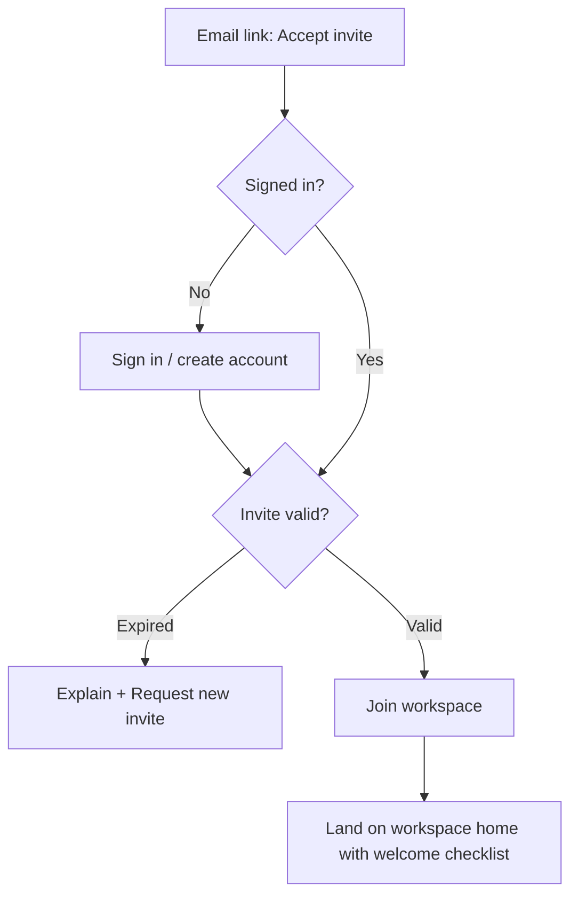

# User Flow Design

## Summary
Designing the sequence of screens, decisions and system responses a user goes through to complete a task, including entry points, branches, errors, interruptions and exits. Engineers use flows to scope routes, states, and edge cases before building, and to reduce steps and friction.

## Category
UX

## Subcategories
task flows, user journeys, flow diagrams, state machines, edge cases, interruption recovery, deep linking, step reduction

## Problem It Solves
Features built screen-by-screen miss the gaps between screens: what happens after submit, when the session expires mid-task, when the user arrives from an email link, or when they go back. Result: dead ends, lost input, duplicated submissions and confused users.

## When To Use
- Any multi-step task (signup, checkout, invite teammate, import data, publish).
- Before estimating a feature: flows expose hidden states and endpoints.
- Debugging drop-off in analytics funnels.

## When Not To Use
- Single-screen, stateless interactions (a toggle).
- As a substitute for usability testing; flows are hypotheses.

## Core Principles
1. **Start from the user's goal and entry points**, not from the first screen you imagine (email link, notification, search result, deep link).
2. **Minimize steps, not clicks at any cost**: remove decisions and data entry; don't cram unrelated questions onto one screen.
3. **Every step has a clear next action and a way back/out** (User control and freedom).
4. **Design the unhappy paths**: validation errors, server failure, timeout, permission denied, empty data, conflict.
5. **Preserve progress**: never lose user input on error, refresh, back navigation or re-auth.
6. **Defer non-essential steps** (account creation, profile completion, preferences) until after value.
7. **Confirm completion and show what happens next** (Peak-End rule: endings shape memory).
8. **Model complex flows as explicit state machines.**

## Best Practices
- Write flows as: Trigger -> Steps -> Decision points -> Outcomes (success, recoverable failure, exit).
- "One thing per page" for complex or infrequent tasks (GOV.UK pattern); combine for short, familiar tasks.
- Show progress for 3+ steps ("Step 2 of 4") and allow reviewing answers before submit ("Check your answers").
- Make the browser Back button work: each step is a URL or history entry.
- Idempotent submissions: disable double submit and use idempotency keys server-side.
- On session expiry, re-auth in place and resume, keeping form state.
- Deep links into a flow must validate prerequisites and redirect gracefully with explanation.
- Success pages: confirmation, reference number, next steps, link back to the relevant object.
- Track funnel events per step (viewed, completed, errored) to find drop-off.

## Implementation Guidance

Flow spec template (keep in the PR or design doc):

```
Flow: Invite teammate
Goal: Admin gives a colleague access with correct role
Entry points: Settings > Members; empty state on Projects; onboarding checklist
Preconditions: user has role admin; seat available (else upsell branch)
Steps:
  1. Enter emails (multi) + role -> validate format, dedupe, existing members
  2. Review (optional if <= 5 invites)
  3. Send -> optimistic list update
Outcomes:
  success: toast "3 invites sent" + pending rows with Resend/Revoke
  partial: "2 sent, 1 failed: x@y already a member"
  no seats: inline message + "Add seats" (billing permission) or "Ask an admin"
  network error: keep input, "Couldn't send invites. Try again."
Exit: Cancel returns to Members without changes
```

State machine for a multi-step flow (XState v5 style, or a reducer):

```ts
type Step = "details" | "payment" | "review" | "submitting" | "done" | "error";
type Event = { type: "NEXT" } | { type: "BACK" } | { type: "SUBMIT" } | { type: "RESOLVE" } | { type: "REJECT"; message: string } | { type: "RETRY" };

const transitions: Record<Step, Partial<Record<Event["type"], Step>>> = {
  details: { NEXT: "payment" },
  payment: { NEXT: "review", BACK: "details" },
  review: { SUBMIT: "submitting", BACK: "payment" },
  submitting: { RESOLVE: "done", REJECT: "error" },
  error: { RETRY: "submitting", BACK: "review" },
  done: {},
};
export const next = (s: Step, e: Event): Step => transitions[s][e.type] ?? s;
```

Step-count decision table:

| Task type | Recommended structure |
|---|---|
| Frequent, short (<5 fields) | Single screen, inline validation |
| Infrequent, many questions, branching | One question/topic per page + check answers |
| Configuration with live preview | Single screen with sections + sticky preview |
| Long setup across sessions | Checklist with saved progress |
| High-stakes irreversible | Review step + explicit confirmation |

## Recommended Workflow
1. Define goal, user, entry points, success metric.
2. Map happy path as boxes and arrows (FigJam/Mermaid).
3. Add decision diamonds and every failure/edge branch; list system states.
4. Cut steps: remove, defer, prefill, infer (e.g., country from locale, city from postcode).
5. Map to routes/state machine and API calls; identify idempotency and persistence needs.
6. Prototype and test 5 users on the task; watch hesitation points.
7. Instrument funnel events; review drop-off after launch.

## Patterns
- **Check your answers**: summary with "Change" links returning to the step and back to summary.
- **Save and resume**: autosave draft; "Continue where you left off" entry.
- **Branching question**: answer determines next step; URL reflects branch.
- **Interstitial explanation**: short "Before you start" page listing what's needed (documents, time).
- **Post-success handoff**: land on the created object with contextual next actions.

## Anti-Patterns
- **Dead-end success page** ("Success!" and nothing else) — Fix: next steps and link to object.
- **Clearing form on error** — Fix: preserve values, focus error summary.
- **Back button exits the whole flow** — Fix: history entries per step.
- **Forced signup before value** — Fix: guest/deferred account creation.
- **Hidden branch requirements** discovered at last step (e.g., "requires business account") — Fix: surface eligibility at start.
- **Modal-in-modal flows** — Fix: dedicated route or full-screen step.
- **Double submit charges** — Fix: disable while pending + idempotency key.

## Accessibility
- Move focus to the new step heading on step change; announce step ("Step 2 of 4: Payment") via page title update.
- Timing adjustable (2.2.1): warn before session timeout and allow extend.
- Redundant entry (3.3.7, WCAG 2.2): don't ask for the same info twice in a flow; prefill or allow selection.
- Error prevention for legal/financial (3.3.4): reviewable, reversible or confirmed.

## Responsive Design
- Keep steps short enough for mobile; sticky primary action at bottom.
- Don't depend on side-by-side comparison in flows on small screens; use summaries.

## Performance
- Prefetch next step's code/data; keep transitions under ~1s.
- Persist drafts locally (sessionStorage/IndexedDB) to survive reloads cheaply.

## Security
- Validate every step server-side; clients can skip steps via URL.
- Don't put PII in step URLs; use server-side session or opaque draft IDs.
- Re-authenticate before sensitive final steps (payment method change, email change).

## Testing
- E2E test per branch (Playwright): happy path, validation error, server error, back navigation, refresh mid-flow, deep link to step 3.
- Unit test the state machine transitions exhaustively.
- Funnel analytics dashboards per step.

## Tooling
- FigJam/Miro/Whimsical or Mermaid (flowchart in markdown) for diagrams; XState / Stately for state machines; PostHog/Amplitude funnels.

## Framework Notes
- **Next.js (App Router)**: one route segment per step (`app/onboarding/[step]/page.tsx`) so Back/refresh work; validate prerequisites in the page (Server Component) and `redirect()` if a step is skipped; submit each step with a Server Action + `useActionState` (returns field errors and preserves values); persist draft server-side keyed by an opaque draft ID in a cookie; final success page is its own route.
- **React (Vite SPA)**: route per step (React Router/TanStack Router) or `useReducer` state machine synced to URL search params; persist draft to `sessionStorage`; use `useTransition`/`useActionState` for pending state on submit.

## AI Agent Guidance
- Do: write the flow spec (entry, steps, outcomes, errors) before coding; implement every outcome branch; keep input on error.
- Don't: build only the happy path; don't use in-memory-only state for multi-step flows without persistence.
- Verify: Back/refresh behavior, double-submit prevention, focus moves on step change, success page has next actions.

## Examples


```tsx
// app/onboarding/[step]/actions.ts — per-step Server Action that preserves input and routes forward
"use server";
import { redirect } from "next/navigation";
import { z } from "zod";
import { saveDraftStep } from "@/lib/drafts";

const Details = z.object({ company: z.string().min(1, "Enter your company name"), size: z.enum(["1-10", "11-50", "51+"], { message: "Select your company size" }) });
export type StepState = { values: Record<string, string>; errors?: Record<string, string[]> };

export async function submitDetails(_prev: StepState, formData: FormData): Promise<StepState> {
  const values = Object.fromEntries(formData) as Record<string, string>;
  const parsed = Details.safeParse(values);
  if (!parsed.success) return { values, errors: parsed.error.flatten().fieldErrors };
  await saveDraftStep("details", parsed.data); // server-side draft, survives refresh
  redirect("/onboarding/invite");
}
```

```tsx
// app/onboarding/[step]/details-form.tsx
"use client";
import { useActionState } from "react";
import { submitDetails, type StepState } from "./actions";

export function DetailsForm({ initial }: { initial: StepState }) {
  const [state, action, pending] = useActionState(submitDetails, initial);
  return (
    <form action={action} noValidate>
      <p className="text-sm text-neutral-600">Step 1 of 3</p>
      <label htmlFor="company">Company name</label>
      <input id="company" name="company" defaultValue={state.values.company} aria-invalid={!!state.errors?.company} aria-describedby="company-error" />
      {state.errors?.company && <p id="company-error">{state.errors.company[0]}</p>}
      {/* size radios ... */}
      <button type="submit" disabled={pending}>{pending ? "Saving..." : "Continue"}</button>
    </form>
  );
}
```

## Related Skills
- [multi-step-forms-and-wizards](../multi-step-forms-and-wizards/Skill.md) — component-level wizard implementation
- [information-architecture](../information-architecture/Skill.md) — where flows live in the structure
- [onboarding-ux](../onboarding-ux/Skill.md) — first-run flows
- [error-states](../error-states/Skill.md) — designing failure branches
- [checkout-flow-design](../checkout-flow-design/Skill.md) — commerce flow specifics
- [conversion-ux](../conversion-ux/Skill.md) — reducing funnel friction

## Sources
- [GOV.UK Service Manual: structuring forms / one thing per page](https://www.gov.uk/service-manual/design/form-structure) — Official — one thing per page, check answers
- [GOV.UK Design System patterns](https://design-system.service.gov.uk/patterns/) — Official — check answers, confirmation pages
- [NN/g User Journeys vs User Flows](https://www.nngroup.com/articles/user-journeys-vs-user-flows/) — Community — distinction and mapping
- [Laws of UX: Peak-End, Goal-Gradient, Zeigarnik](https://lawsofux.com/) — Community
- [Baymard Institute checkout research](https://baymard.com/learn/reduce-cart-abandonment) — Community (research) — forced account creation drop-off (19%)
- [WCAG 2.2](https://www.w3.org/TR/WCAG22/) — Official — 3.3.7 redundant entry

## License / Usage Notes
GOV.UK content under OGL v3.0; summarized. Code original.

## Quality Tier
A — combines official government service design practice with engineering state modeling.

## Status
Active

## Last Verified
2026-09-15
